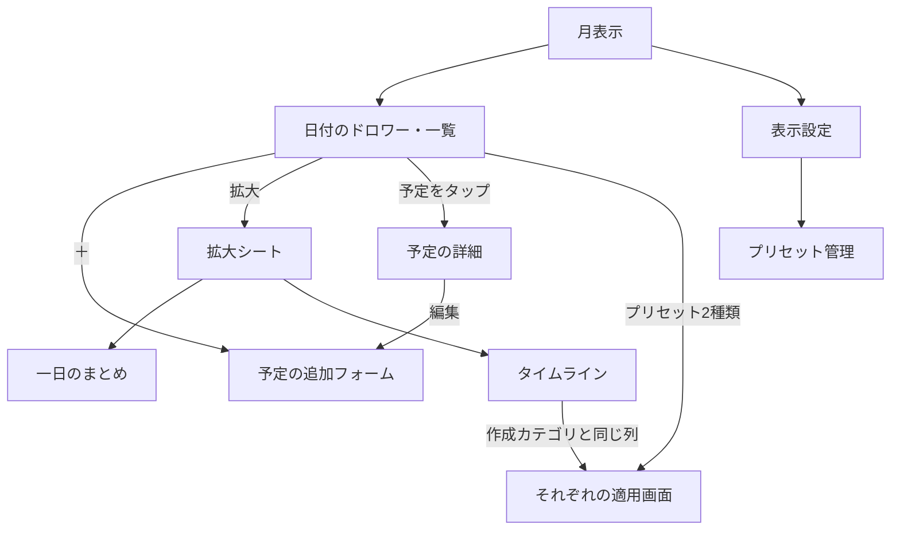

# 35. カレンダーの導線・情報量の刷新

更新: 2026-09-29 / Codex

状態: **ユーザーの指示で§13の一段化・その他メニュー化を差し戻し。×は＋の右側へ復元。プリセットの配置改善は未解決（§14）。**
目的別入口は§8、現在の差し戻し状態は§14を優先。§9〜13は検討・試作の記録。05・22・28・33・34のその他の確定済み挙動は維持する。

## 1. 今回の目的

ユーザーの課題は、機能不足ではなく「階層が深い機能」と「見えすぎる選択肢」。機能を維持しながら、使う場面に合わせて配置と強弱を見直す。

優先する場面はユーザー回答により **「日付を選び、予定を足したり動かしたりする」**。
まず月表示→当日ドロワー→タイムライン→追加・移動の流れを対象にする。
プリセット管理全体、繰り返し・通知の詳細編集は、この流れに必要な入口の整理から着手する。

## 2. 確認した構造と改善候補

以下はソースから確認した構造。画面上での目立ち方、操作の迷いやすさは未検証の仮説として区別する。

| 段階 | 現状と評価 | 根拠 | 改善候補 |
|---|---|---|---|
| 1. 月から日付選択 | 月を残した小さい当日一覧は、短い確認に適している。維持する価値がある | `CalendarView.monthDrawerSheet`、`CalendarMonthDayDrawer.body` | この一覧を日付の作業入口として維持 |
| 2. 時間を見て予定を組む | 拡大アイコン→別シート→保存設定によって「一日のまとめ」またはタイムライン。未設定時はまとめになるため、時間を触るまでに表示切替が必要 | `CalendarMonthDayDrawer`の`onExpand`、`CalendarDayPagerSheet.init/body` | タイムラインへ直接進む、目的の分かる入口を用意。まとめも近くに残す |
| 3. 予定を作る | タイムラインの横並びに「予定プリセット」「一日プリセット」が先行し、その後に作成カテゴリ・カテゴリ追加が並ぶ。役割の違う操作が同じ列を使う | `CalendarTimelineCategoryPalette.body` | 作成カテゴリとライブラリ入口を分け、現在のカテゴリを常に確認できる配置にする |
| 4. 予定を動かす・編集する | 一覧行→詳細→編集の経路がある。一方、別日移動は一覧から長押しで直接でき、タイムラインも直接移動・伸縮できる | `CalendarMonthDayDrawer.detail/planSurface`、`EditablePlanTimelineView` | 既存の直接操作を主軸にする。予定を選んだ時に編集・移動など対象の操作を近くに出す |
| 5. プリセットを使う・整える | 当日一覧には適用2種類、管理はカレンダー表示設定の中にも存在。適用と管理が離れている | `CalendarMonthDayDrawer.listContent`、`CalendarSettingsView` | ライブラリから管理へ直接進める入口を検討。並べ替えなど管理操作はライブラリ内で表示 |
| 6. 詳細編集 | 名前・重要度・時間が先頭にあり、その後も役割、カテゴリ、通知、繰り返し、公開、メモのカードが続く | `PlanCreateSheet.body` | 時間調整だけならタイムライン内で完了。詳細編集では各設定の現在値を短い行で示し、値を変える時に必要な選択肢を展開 |

### 現在の主経路

拡大シートの初期表示は保存設定に依存する。上図のまとめ・タイムラインは同じシートの切替であり、毎回両方を経由するわけではない。新規予定フォームもドロワーから直接開けるため、「すべての追加が深い」という問題ではない。

## 3. 推奨する方向

### A. 日付を選んだ文脈のまま、時間を組める

小さいドロワーの一覧を保ち、時間を調整したい時は **「タイムライン」** と分かる入口から直接進む。別の日に移動しても、戻っても、対象日と直前の位置を見失わない。

拡大時は同じ日付の作業が広がったように見せる。実装を一つのsheetへ統合するかは別途検証する。見せ方の改善のために、検証済みのドラッグ・スクロールの所有関係を大きく組み替えない。

「一日のまとめ」は近くの一回の切替で残す。既存の「最初に開く画面」設定の扱いは、完成イメージを比較して決める。保存済みの希望を黙って上書きしない。

### B. 何も選んでいない時と、操作中の情報を分ける

| 状態 | 主に見せるもの | 必要になった時に出すもの |
|---|---|---|
| 日付を選んだ直後 | 日付、予定一覧、追加、タイムライン入口 | 予定の移動・複製など対象が必要な操作 |
| タイムラインで時間を組む | 時間軸、予定、作成カテゴリ、プリセット入口 | カテゴリ管理・表示設定 |
| 予定を選択 | 時刻、移動・伸縮、編集への入口 | 削除など頻度の低い操作 |
| ドラッグ中 | 指に追従する予定、時刻、着地点・重なり | 確定が必要な置換選択は指を離してから |
| プリセットを探す | 最近作った未登録予定、保存したプリセット | 検索・絞り込み・並べ替え・管理 |

選択するだけで操作が現れることと、別途「編集モード」に入ることを混同しない。新しい編集モードは追加しない。ドラッグが苦手な人向けのタップ式移動も維持する。

### C. プリセットは作る場所の近くへ

候補は、共通の「プリセット」入口からライブラリを開き、中で「予定 / 一日」を選ぶ構成。検索・並べ替え・管理をライブラリ内にまとめる。カテゴリの横スクロールから独立した位置に入口を置く。

ただし入口を一つにすると、一日プリセットの適用に切替が一手増える可能性がある。件数削減だけで採用せず、二つを小さく並べる案と画面上で比較する。日常的な追加をすべて＋メニューの奥に入れる案は避ける。

### D. 詳細設定は、現在値を読めるまま軽くする

重要な予定の星と時間は上部に残す。「通知 10分前」「繰り返し 毎週月曜」のように設定の存在と現在値は見せ、変更時だけ選択UIを展開する。内容不明の「その他」へ一括でしまわない。

繰り返し由来の予定は「この日だけ／繰り返しの元」の対象差を見える状態に保つ。任意の長い説明は、これまでどおり関連項目の情報ボタンから吹き出しで表示する。

## 4. 最初の実装候補と完了条件

最初は **当日ドロワーと拡大タイムラインの入口・操作帯** に絞る。UI案を比較した後に実装範囲を確定する。

- 月で日付を選んだ後、まとめを経由せず一回の操作でタイムラインへ入れる。
- 当日一覧の確認と、既存の＋からの予定追加は遠回りにしない。
- タイムラインの作成カテゴリと、プリセット・管理操作の違いが分かる。
- 予定の作成・移動・伸縮は既存の直接操作を維持する。
- 戻る時に月・対象日・ドロワー高さを復元し、日付を送り直さなくてよい。
- メイン／メモの操作、置換確認、固定時刻／長さ型プリセット、月へのドロップを維持する。
- 過去日の制限、外部予定、空日、カテゴリ多数、長い名称、文字拡大、VoiceOverで入口を確認する。
- 通常Release実機で追加・移動・スクロール・戻りの操作感を確認する。SimulatorのDebug動作から性能改善を主張しない。

全タブとHomeの記録入口を維持する。月・日・週の機能、まとめ、共有範囲、繰り返しのデータモデルの変更は、この初回の対象に含めない。

## 5. 調査の範囲と残り

対象checkoutは`codex/ux3-timeline-performance`の未コミット変更を含む状態。既存変更を保ったままコードの導線を確認した。アプリコードは変更していない。

2026-09-28に現行checkoutの`Liminalog-UIRegression / Debug / iPhone 17 iOS 26.5`を新しいDerivedDataでビルドし成功。ログは`/private/tmp/liminalog-calendar-ia-20260928/build.log`。これはUIの操作確認や性能測定ではない。

画面操作ツールは、起動中のSimulatorを列挙できたが、名前・パス・bundle IDでの取得がすべて`Invalid app`となり、再初期化後も解消しなかった。今回の新規スクリーンショットと画面ウォークスルーは未取得。過去のスクリーンショットは今回の監査根拠として使っていない。

同日追記: ユーザーの「続けよう」により具体案へ進行。simctlで隔離fixtureを起動し、月表示・日表示・プリセットライブラリの新規静止画3枚を取得。現行のプリセット2入口がカテゴリ列の先頭を占めること、ライブラリに最近の予定・検索・カテゴリ絞り込みが同時表示されることを画像でも確認した。ドロワーから拡大への連続操作は未確認のまま。

現行画像3枚とコード上の部品・挙動をImage Genへ添付／指定し、同じ2状態を比較する3案を作成。チャットの生成結果表示順は「1: 一覧から時間へ」「2: 日付の作業台」「3: 手元で予定を組む」。[比較資料・画像・注意点](../../../../design/calendar-refinement-20260928/README.md)に保存。2案目のメモが横並びに描かれた点は生成上の不一致で、採用時に全幅メインへの重なりに修正する必要がある。ユーザーへも伝達済み。

次は選択案を修正し、プリセットの手数、拡大先設定、短い一覧の保持を詰める。静止画だけで操作感改善や監査完了を主張せず、確定後に本番UIへ反映する。

## 6. 初回3案へのフィードバックと検討し直す範囲

ユーザーは3案とも方向が合っていないと評価。§3〜4および生成画像を確定仕様として実装しない。

維持する基準:

- 日付選択で出る当日ドロワーは、今のカテゴリ・アイコン付き予定一覧が最も見やすい。色の棒や点だけの一覧へ置換しない。
- 下部に予定追加・プリセットを固定配置する案は採用していない。

ユーザーが提示した検討候補（未確定）:

- アプリ全体で、設定画面以外の予定／一日プリセットの入口をアイコンだけに統一する。長いラベル2つによる幅の占有を減らしたい。
- 拡大後の「一日のまとめ／タイムライン」のタブ切替は、どちらか片方へ絞ると簡潔になる可能性がある。
- まとめの情報を当日ドロワーへ控えめに落とし込み、拡大をタイムラインだけにする案。
- Homeと同じまとめデザインをカレンダーにも残し、入口だけを変える案。
- 月間／週間／日間の切替をもっと簡単にする。これらの仕様についてまず相談したい。

コード確認: Homeのリスト表示とCalendarは`CalendarDayView`を共用している。まとめはスコア・重要な予定・予定と実績のタイムラインを含む。ドロワーへの全面移植を前提にせず、共通デザインを残す案と比較する。

次の相談の軸: 月／週／日の切替を常時一操作にし、ドロワーの拡大を選択日の「日」表示へ接続するか、それとも月表示の上に開く別シートを維持するか。どちらも既存の一覧・カテゴリのアイコン・ドラッグ操作を維持する前提で、未承認の提案として扱う。

## 7. 採用した仕組みと切替方式の条件

ユーザーの追加フィードバックにより、以下を区別する。この節は§3〜6の未確定案より優先する。

### 採用

- **タイムラインと一日のまとめは、別々のボタンから直接開く。** 開いた後に2つの表示から選び直させる導線を整理する。
- 当日ドロワーは既存のカテゴリ・アイコン付き一覧を基準にする。
- 入口の配置・アイコン・ボタンの大きさは、仕組みの採用とは分けて引き続き検討する。

### 条件付きの検討

- 操作ボタンが上部にあると片手で扱いづらい。頻繁に使う入口と戻りは下側で操作できる配置を検討する。
- 月／週／日の切替は、ボタンを下側に置き、**今のドロワーより明確に素早く操作できる場合**に切替形式も候補となる。「拡大＝日表示への切替」はまだ採用していない。
- 同じタップ回数でも、カレンダーの表示モードが変わる感覚と、月の上にドロワーが開く感覚は異なる。描画時間だけで比較しない。
- 月が背面に残る現行の文脈、閉じれば元へ戻れる感覚、対象日が分かる状態を比較基準にする。
- 下側への配置条件は、初回画像案の「予定追加・プリセットを大きな下部固定欄にまとめる」ことの採用を意味しない。

### 配置を検討する順序

1. 現行ドロワーに、タイムライン／まとめの独立した入口を置く。まず片手で開く・閉じる経路を整える。
2. プリセット2種類のアイコン化候補を同じ配置の中で検討し、予定一覧の見える量と押しやすさを保つ。
3. 月／週／日を下側で切り替える案と、月の上に開くドロワー案を、日付選択→追加または移動→月への復帰で比較する。

比較では指の移動量、持ち替え、タップ回数、表示の待ち、戻り方と状態復元を確認する。静止画だけで「現行より速い」と判定せず、動く状態と通常Release実機で確認する。既存のHomeのまとめデザイン、予定の直接操作、5タブは維持する。

## 8. 2026-09-28: 当日ドロワーの入口を実装

直近の提案に対するユーザーの「やってみよう」を受けた範囲。初回3案の画像は参照しない。

- 当日ドロワーの **日付＋小さい右矢印** から、Homeと共通の `CalendarDayView` による一日のまとめを開く。
- **時間軸アイコン** から、選択日の編集できるタイムラインを直接開く。ルートの日間タブへ切り替えず、従来どおり月の上に大きなシートを表示する。
- 一覧上部の「予定プリセット」「一日プリセット」の文字付き2ボタンを、見出しのしおり／時計付きカレンダーアイコンへ移動。＋と閉じるを含め44ptの操作領域を持たせ、VoiceOverには用途のラベルを残す。
- 予定の詳細では従来どおりプリセット入口を隠し、一覧へ戻るボタンを表示する。見出しの変更は一覧／詳細の切替と同じ時間でアニメーションする。通常文字サイズの詳細で見出しが二段になり、本文を圧迫することを避ける。
- 文字拡大時や幅が足りない場合は日付と操作列を二段にする。文字は拡大し、アイコンは固定寸法で重なりを避ける。
- 開いた後の「一日のまとめ／タイムライン」切替と、表示先を選ぶカレンダー設定を撤去。表示先は押した入口だけで決まる。旧 `calendar.month.expandedDayMode` の保存値自体は削除・上書きしない。
- カテゴリのアイコン付き一覧、予定の詳細、長押し移動、詳細からの右スワイプ、月への復帰時の選択日とドロワー高さを維持する。

今回変更しない候補: 月／週／日の切替UI、アプリ全体のプリセット入口、タイムラインのカテゴリ列、Homeのまとめ、予定編集・繰り返し・通知の仕様。

### 検証

- iPhone 17 / iOS 26.5 Simulator / Debug: `regression.xcresult` の10件と `header-final.xcresult` の3件成功（重複を除き12種類）。目的別の入口、旧初期表示設定からの独立、44ptのボタン領域、文字拡大、詳細の高さ保持、見出し／余白からの戻り、タイムラインで作成・移動・伸縮、スクロールとの競合、日付移動後のプリセット適用、一覧から別日移動、月間の長さ型・終日・一日プリセットを確認した。
- 初回検証で見つかった、親のaccessibilityIdentifierによるボタン識別の上書き、拡大されたアイコンの重なり、詳細の見出しが二段になる圧迫を修正。最終テストではシート座標変換による隣接境界の1pt未満の丸めを許容し、視覚的な重なりも画像で確認した。
- 通常Release: `normal-ready.log` のbuild成功。署名を検証し、UI fixture・拡大計測のシンボルがバイナリに含まれないことを確認した。
- iPhone 16 / iOS 26.6.2 / Release・隔離fixture: `device-retry.xcresult` の8件すべて成功。目的別入口と元位置への復帰、文字拡大、見出し／余白からの右スワイプ、作成・移動・伸縮、日付移動後の予定／一日プリセット、一覧から別日移動、月間の長さ型・終日プリセットを確認。実機のダーク表示の画像も確認した。
- 実機の初回テストは通常Homeから起動し、fixtureに到達する前に失敗したため中止。テスト用バイナリを明示的にインストールしてから同じ条件で再実行すると成功。初回の起動状態の原因は未特定で、UIの機能不良とは切り分ける。
- 全UIテスト終了後、通常Releaseをデータを保持してiPhoneへ再インストールし、テスト引数なしで起動成功（`normal-install.json` / `normal-launch.json`）。

ログとxcresult: `/private/tmp/liminalog-calendar-entry-20260928/`。画面は [実装記録](../../../../design/calendar-refinement-20260928/implementation/README.md) に保存。表示速度や実指での操作感の改善は、この自動テストからは主張しない。

## 9. 同日: 見出しを役割でまとめ、強弱を付ける

**この節の見た目は不採用。** 動作テストの成功と、ユーザーが扱いやすいと評価することを区別する。次の修正は§10を参照。

ユーザーの指摘: 4つのボタンが並列に見えると認知負荷が高い。頻度や用途が近い要素をまとめ、それぞれのアイコンを個別に読み解かなくても区別できる見せ方が必要。

- **表示操作**: 日付と時間軸を左にまとめ、時間軸は補助的な色で表示する。
- **追加操作**: ＋・予定プリセット・一日プリセットを共通の薄い背景に収める。＋は塗りつぶし、プリセット2つは補助として並べる。区切り線でも役割の違いを示し、色だけに頼らない。
- **閉じる**: 右端で余白を取り、表示／追加と分離する。
- 新しいメニュー階層は増やさず、各操作は従来どおり直接実行。通常サイズで一行、文字拡大時は表示操作と追加操作を上下に分ける。押せる範囲は44ptのまま。
- 一覧の内容、日付と時間軸の行き先、詳細のスワイプ、プリセットの適用処理は変更しない。

検証ログは `/private/tmp/liminalog-calendar-grouping-20260928/`。

- `simulator.xcresult`: iPhone 17 / iOS 26.5 / Debugの6件成功。新規テストは追加せず、入口・文字拡大・詳細の高さ・余白からの戻り・予定／一日プリセット適用の既存回帰テストを実行した。
- `device.xcresult`: iPhone 16 / iOS 26.6.2 / Release・隔離fixtureで同じ6件成功。実機のダーク表示と文字拡大時の画像も確認した。
- `normal.log`: 通常Releaseのbuild成功。署名を検証し、UI fixture・拡大計測のシンボルが含まれないことを確認。
- 実機テスト後、通常Releaseをデータを保持してiPhoneへインストールし、テスト引数なしで起動成功。同一プロセスの継続も確認した（`normal-install.json` / `normal-launch.json` / `normal-processes.json`）。

画面と確認内容: [グループ化の変更前後](../../../../design/calendar-refinement-20260928/grouped-header/README.md)。認知負荷や操作時間の改善は未測定で、機能の検証とは区別する。

## 10. 同日: プリセットだけをまとめ、＋を右端へ分離

ユーザーの指摘: §9のグループ化は逆効果。まとめるのはプリセット2つ。＋は強調してよいが、大きな塗りつぶし円は適切でなく、一番押しやすい右側に置くべき。

試作した修正（不採用）:

- プリセット2つだけを近接と薄い共通背景でまとめる。
- ＋はプリセットの背景から外し、右端に独立させる。塗りつぶし円をなくし、位置・余白・アイコンの大きさで強調する。
- 日付／タイムライン／閉じるの行と、プリセット／＋の行を分ける。既存のドロワー高で予定一覧がどこまで見えるかを実画面で確認する。
- 各入口の手数、日付と時間軸の行き先、一覧／詳細の戻り方は維持。

通常サイズの一覧では3件を表示できたが、詳細画面の操作欄が下へ押し出され、余白から戻る回帰テストが失敗した。二段化を取りやめ、閉じるを左端・＋を右端とする一列の配置も試作し、Simulatorの既存6件は成功。ただしその後、ユーザーからプリセット入口をカレンダー画面へ出す方向が提示されたため、この一列案も通常版へ採用せず保留。今回の見出しコード変更は試作前の状態へ戻した。

ログ: `/private/tmp/liminalog-calendar-header-v2-20260928/`。`simulator.xcresult` は二段案で5/6、`compact.xcresult` は一列案で6/6。二段案の実機テストは中断。一列案の実機テストは未実施。これらを移設後の検証実績として扱わない。

## 11. 同日: プリセット入口をカレンダー側へ出す方向

ユーザーの追加フィードバック: 二段化も違う。ドロワーではなくカレンダー画面にプリセットボタンを置く方がよいかもしれない。

検討案（位置・挙動の確定前、未実装）:

- 当日ドロワーは日付・タイムライン・右端の＋を中心とした一列に戻す。プリセット2つをドロワーから外す。
- 2つのプリセット入口は、カレンダー側で一組として扱う。片手操作を考慮し、カレンダーの見えている範囲の下側を配置候補とする。ドロワーの開閉時も使えて、日付のセルを覆わない配置を検討する。
- プリセットは「先に日付を開かないと使えない機能」から、予定をカレンダーの日付へ配る道具として扱う。
- 予定プリセットには月の日付へのドラッグ適用がすでにある。一方、タップ適用と一日プリセットは現状では確定した対象日を必要とする。日付未選択で入口を開いたときに今日などへ暗黙適用しないよう、対象日を選ぶ導線も合わせて設計する。

今回の試作は通常版へ反映せず、実機は試作前の通常Releaseへ復帰済み。`restored-normal.log` でbuild成功、署名とfixture／計測シンボルの非包含を確認し、`restored-install.json` / `restored-launch.json` で再インストールとテスト引数なしの起動成功を確認した。新しい配置の実装・検証はまだ完了していない。

## 12. 2026-09-29: カレンダー上部にプリセット入口を移設

ユーザーが、下側はドロワーに隠れるためタイムライン同様にカレンダー上側へ置く方向を提示。「月タイトルの下・曜日列の上」という提案に対し「じゃあ進めて」と依頼。

- 月表示の上部に、予定／一日プリセットのアイコン2つを一組で配置。日付未選択でも、当日ドロワー表示中でも同じ入口から使える。
- 当日ドロワーからプリセット2つを移し、通常サイズは一列。＋は塗りつぶし円をなくして右端へ独立。閉じる操作は左端の下向き矢印にし、日付→まとめ、時間軸→タイムラインは維持。
- 日付選択済みではその日を引き継ぐ。未選択からタップ適用する場合は「追加する日」の日付入力を表示。初期値は表示中の月内の今日、または表示中の月の1日で、適用前に確認・変更できる。自動保存はせず、明示した日付へ追加ボタンで適用する。
- 予定プリセットのドラッグは置いた日を使用し、固定時刻／終日は直接適用、長さ型は開始時刻を指定する既存挙動を維持。
- 適用後は対象日のドロワーへ戻る。対象月が変わる場合はその月へ移動。キャンセル時は元の選択日・ドロワー状態を維持。
- 予定の移動中もプリセット欄の高さを保ち、日付セルを動かさず入口だけ一時的に操作不可にする。
- 今回の範囲は月表示の入口。日間／週間のプリセット操作、Home、繰り返し・通知、置換の計画ロジックは変更しない。

検証（iPhone 17 / iOS 26.5 Simulator、隔離fixture）:

- UIテスト15項目成功。通常／拡大文字サイズの配置、目的別入口、未選択からの適用・日付変更・直接ドラッグ、選択済みの日付への適用、固定時刻／長さ／終日、置換、外へのドロップ、予定移動、詳細下部の余白から戻る操作、拡大タイムラインで日付移動後の適用を確認した。
- 拡大タイムラインのテストで、背面にある月表示の同名ボタンとテスト検索が競合した。月表示側の読み上げ名に「月表示で」を付けて区別し、再実行成功。拡大中の背面ボタンは操作不可であることも確認した。VoiceOver実操作の検証とは区別する。
- 通常表示とアクセシビリティ文字サイズを画像で確認。通常サイズは一列、大きな文字では日付のみ同じ操作列内で折り返し、ボタンの重なりはない。[今回の実画面](../../../../design/calendar-refinement-20260929/README.md)。
- 最終コードで通常Release build成功（`normal-verified.log`）。署名検証に成功し、fixture／拡大表示の計測シンボルが含まれないことを確認（`normal-signature.log`、`normal-fixture-check.log`）。
- iPhone 16は最終確認でもCoreDeviceが`unavailable`を返した。今回の実機インストールとReleaseでの指操作確認は未実施。実機には前回復帰した通常版を残している。操作時間・認知負荷・指での操作感が改善したという測定結果ではない。

ログ: `/private/tmp/liminalog-calendar-preset-bar-20260929/`。成功結果は`entry.xcresult`、`regression.xcresult`、`date-and-drag.xcresult`、`final-regression.xcresult`の成功3項目と、修正後の`modal-final.xcresult`。実機状態は`devices-final.json`。

## 13. 2026-09-29: 専用行をなくし、見出し内にまとめる

§12に対し、ユーザーから「左に2つだけの行は無駄なスペースでカレンダーが見づらい」「閉じる×をなくすのは悪手」と指摘。プリセットを1つの入口に畳む案との比較では「2つを直接押せるまま、既存の上部操作も整理する」を選択した。

- プリセットの専用行を削除。月表示の既存見出し一段に、表示切替・年月・プリセット2つ・その他メニューを配置する。プリセット2つは同じ背景でまとめ、直接開ける状態を保つ。
- 検索・表示フィルタ・表示設定は、右端の「…」メニューから開く。フィルタ適用中はメニューのアイコンと読み上げ値にも状態を示す。ドロワー表示中に選んだ場合は、既存の閉じ終わりを待つ処理で遷移する。
- ドロワーの左端は元の`xmark.circle.fill`へ復元。＋は右端、日付とタイムラインの入口は維持する。
- 日付未選択／選択済みからのプリセット適用、日付変更、ドラッグは§12の機能を維持。日間・週間の上部操作配置は今回変更しない。

検証（iPhone 17 / iOS 26.5 Simulator）:

- UIテスト8項目成功。通常／拡大文字サイズで操作領域に重なりがないこと、まとめ・タイムラインへの遷移、ドロワー表示中のその他メニュー3項目、プリセットの未選択からの適用、未選択／選択済みからのドラッグ、予定移動、月週日の往復を確認した（`header.xcresult` 3件、`regression.xcresult` 5件）。
- [実画面](../../../../design/calendar-compact-header-20260929/README.md)を確認。通常文字サイズは一段に収まり、従来のプリセット専用行48pt分をカレンダーへ戻した。検索・表示フィルタ・表示設定にはメニューを開く一手が増える。
- 通常Release build、署名、fixture／計測シンボルの非包含を確認（`normal.log`、`normal-signature.log`、`normal-fixture-check.log`）。
- iPhone 16は再確認でもCoreDeviceが`unavailable`。今回の実機インストールと指操作は未実施。操作時間や認知負荷が改善したという測定結果ではない。

ログ: `/private/tmp/liminalog-calendar-compact-header-20260929/`。

## 14. 2026-09-29: 一段化を差し戻し、×を＋の右へ復元

ユーザーから「悪化したから元に戻して。バツは従来通りプラスボタンの右側」と指示。

- §13の一段化とその他メニューを撤回。表示設定・表示切替を左、年月を中央、フィルタ・検索を右に戻す。年月の文字サイズ・余白も元に戻す。
- プリセット2つは直前の変更前と同じ月タイトル下の行へ戻す。専用行への窮屈さの指摘は未解決であり、この配置を改善済み・最終採用とは扱わない。
- ドロワーは日付・タイムライン・＋・×の順。×は元の見た目で＋の右側へ配置する。
- プリセットの日付指定やドラッグ適用の機能は維持し、新しい配置案は追加しない。

Simulator UIテスト2件成功。通常・拡大文字サイズでボタンに重なりがないこと、×が＋の右側にあること、まとめ・タイムラインへの往復を確認。通常Release build・署名・fixture非包含の確認も成功。実機へのインストールは今回未実施。[差し戻し後の画面](../../../../design/calendar-header-rollback-20260929/01-restored-header.png)。

ログ: `/private/tmp/liminalog-calendar-header-rollback-20260929/`。
